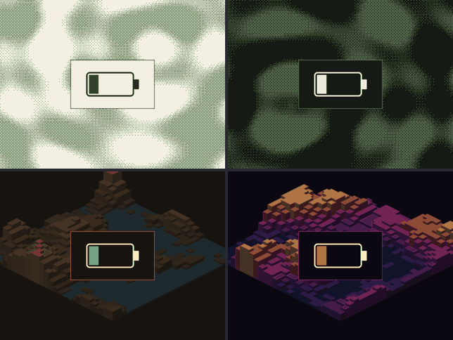

# onion-themes

Generative terrain themes for Onion OS on the Miyoo Mini and Mini Plus.

| Landform Paper | Landform Night |
|---|---|
|  |  |
| Olive ordered-dither terrain on cream paper. [Download](https://raw.githubusercontent.com/antonio-mendes/onion-themes/main/release/Landform%20Paper%20by%20antonio-mendes.zip) | The same, cream on near-black. [Download](https://raw.githubusercontent.com/antonio-mendes/onion-themes/main/release/Landform%20Night%20by%20antonio-mendes.zip) |

| Keep Sandstone | Keep Ember |
|---|---|
|  |  |
| Isometric block terrain in sand and teal. [Download](https://raw.githubusercontent.com/antonio-mendes/onion-themes/main/release/Keep%20Sandstone%20by%20antonio-mendes.zip) | Isometric block terrain coloured by elevation. [Download](https://raw.githubusercontent.com/antonio-mendes/onion-themes/main/release/Keep%20Ember%20by%20antonio-mendes.zip) |

Each theme has its own icons, boot and shutdown screens, a navigation sound,
a menu music loop and a charging animation:



## Install

Copy a zip into the `Themes` folder on the SD card and apply it from the
Themes app (Onion 3.9 or later).

## Build

Everything in a theme is generated by `build.py`: skin images, the 24-frame
charging animation, the sounds and `config.json`.

```sh
python3 build.py out "Your Name"
```

This writes one folder and one `[NAME] by [AUTHOR].zip` per theme into `out/`.
The zips in `release/` are copies of that output.

Requirements: Python 3 with `numpy` and `Pillow`, and `ffmpeg`. The fonts are
in `fonts/`, so nothing needs to be installed system-wide.

## Fonts

The themes bundle these fonts, unmodified. Each zip includes the licence of
the font it uses.

| Font | Used by | Licence |
|---|---|---|
| [Caladea](https://github.com/huertatipografica/Caladea) | Landform Paper | [SIL Open Font License 1.1](fonts/LICENSE-Caladea.txt) |
| [JetBrains Mono](https://github.com/JetBrains/JetBrainsMono) | Landform Night, Keep Ember | [SIL Open Font License 1.1](fonts/LICENSE-JetBrainsMono.txt) |
| [DejaVu Sans](https://dejavu-fonts.github.io/) | Keep Sandstone | [Bitstream Vera licence](fonts/LICENSE-DejaVu.txt) |

## Status

Tested on a Miyoo Mini Plus running Onion. The screenshots above were taken
on the device.

Submitted to the official theme repository in
[OnionUI/Themes#51](https://github.com/OnionUI/Themes/pull/51).
